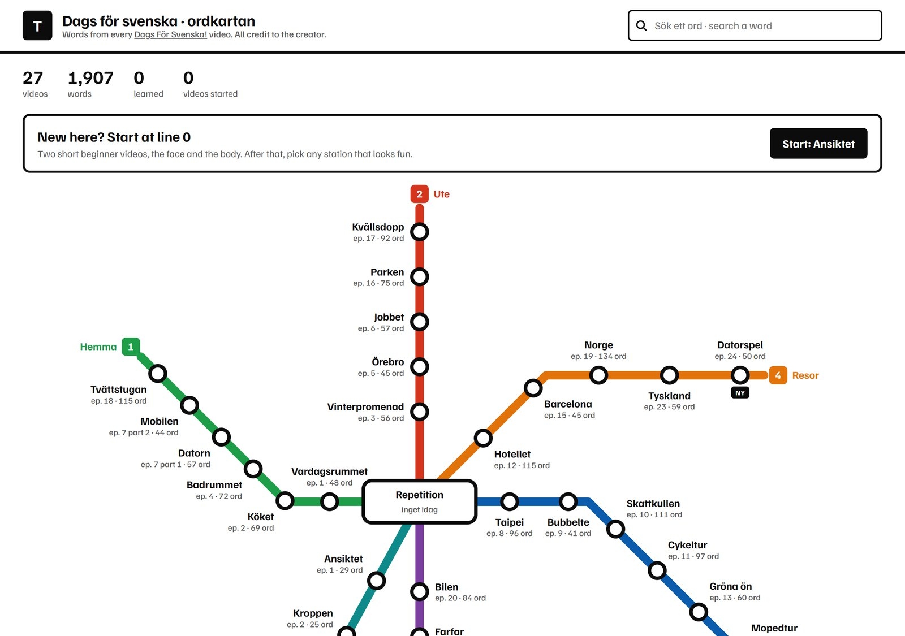
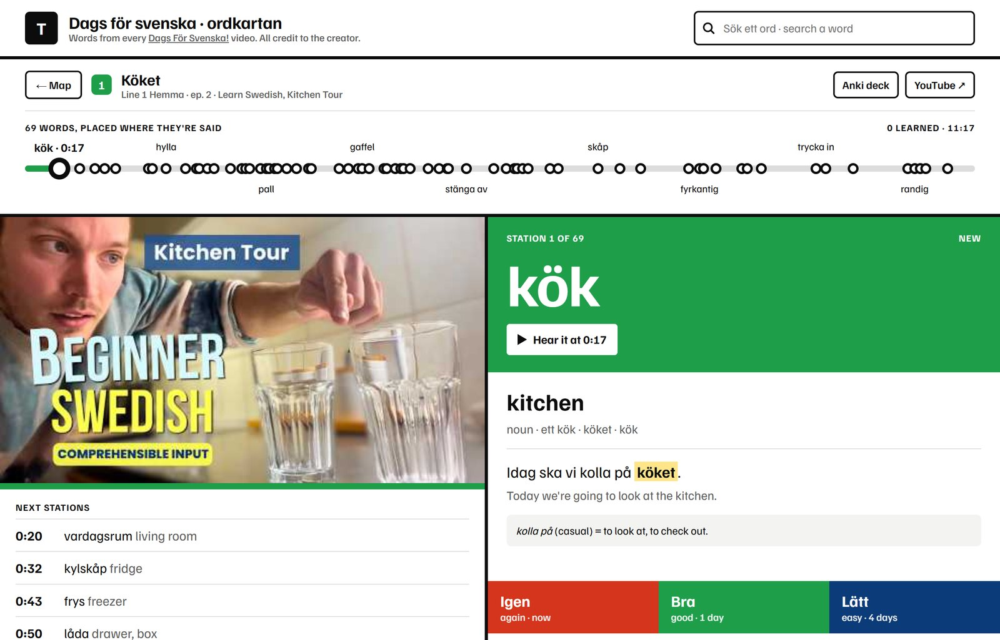
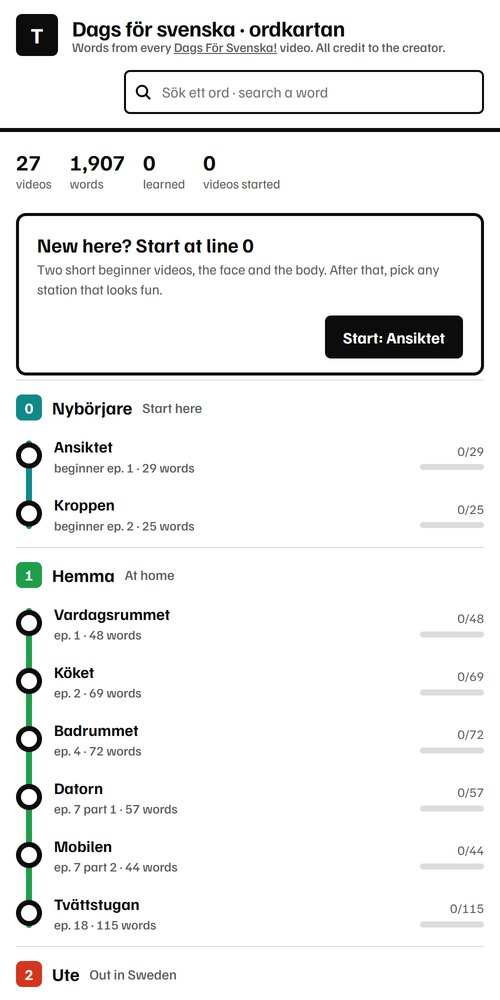
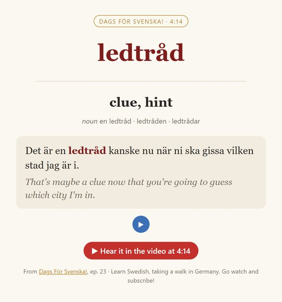

# Dags För Svenska · Cards

**Watch a Swedish video, then rehearse its words.** Flashcards built from the words in
[Dags För Svenska!](https://www.youtube.com/@DagsF%C3%B6rSvenska) videos. Every card links back to the
second the word is said, and one click plays that line in the creator's own voice.

### ▶ [Open the study site](https://rajathpi.github.io/dags-svenska-cards/) · ⬇ [Download the Anki decks](https://github.com/rajathpi/dags-svenska-cards/releases/tag/decks)



> **All credit to [Dags För Svenska!](https://www.youtube.com/@DagsF%C3%B6rSvenska).** This is an unofficial,
> fan-made study companion built out of love for the channel. The videos, voice and original content belong to
> the creator. Go watch and subscribe! The cards quote only the one short line where each word appears.
> The full transcripts are not published here, and the audio plays through YouTube's own player.

## How it works

1. **Pick a station.** The videos are laid out as a metro map. Each line is a theme (at home, out in Sweden,
   family, trips abroad, Taiwan), and each station is one video. Line 0 is for complete beginners.
   A ring round each station fills up as you learn its words.
2. **Study its words.** Inside a video, the words sit along a line at the second they're said. You see a
   Swedish word, try to remember it, then *Show answer* for the meaning, the grammar forms and the line from the video.
3. **Hear it for real.** *▶ Hear it* plays just that sentence in the video, in the creator's own voice, and stops.
4. **Rate yourself** *Igen / Bra / Lätt* (again, good, easy). Words you know come back less often and hard ones
   sooner (spaced repetition, like Anki). Due words from every video meet at the *Repetition* hub for one mixed review.
5. **Search** any word to see which video it's from and jump to it.

Progress is saved in your browser, no account needed. The [previous layout](https://rajathpi.github.io/dags-svenska-cards/classic.html) still works and shares the same progress.



| On your phone | In Anki |
|---|---|
|  |  |

**Prefer Anki?** Every video also has an `.apkg` deck with the same cards: Swedish and English audio, the
grammar forms, and a *Hear it in the video* button that opens YouTube at the right second. Import it with
*File → Import*.

## What's inside each card

- the word in its **base form** (*gick → gå*) with grammar forms (*en ledtråd · ledtråden · ledtrådar*)
- a **hand-checked translation**, not machine output
- **the line from the video** where it's said, with an English translation
- a short **tip** where it helps (*utfart* vs *utgång*, how *kiosktätaste* is built, …)
- the **timestamp**, so you can always go back and hear it

## Videos so far

All 27 videos on the channel, 1,907 words.

| Episode | Words |
|---|---|
| [ep. 1 · Learn Swedish, Living Room Tour](https://www.youtube.com/watch?v=5QiJaORvrYI) | 48 |
| [ep. 2 · Learn Swedish, Kitchen Tour](https://www.youtube.com/watch?v=Lhb8CvTQ4To) | 69 |
| [ep. 3 · Learn Swedish, Going Out For A Winter Walk](https://www.youtube.com/watch?v=V68r_qCSBgs) | 56 |
| [ep. 4 · Learn Swedish, Bathroom Tour](https://www.youtube.com/watch?v=WsMo25tCC50) | 72 |
| [ep. 5 · Learn Swedish in Örebro](https://www.youtube.com/watch?v=3_Wj01Of_tw) | 45 |
| [ep. 6 · Learn Swedish, Join me at work](https://www.youtube.com/watch?v=ac_zdq77STk) | 57 |
| [ep. 7 part 1 · Learn Swedish At My Desk, PART 1 (Computer)](https://www.youtube.com/watch?v=jwi4qFGKaUQ) | 57 |
| [ep. 7 part 2 · Learn Swedish At My Desk, PART 2 (Cell Phone)](https://www.youtube.com/watch?v=RPZvVC8Hm-g) | 44 |
| [ep. 8 · Learn Swedish in Taipei, Yanping Riverside Park (Taiwan Travels vol. 1)](https://www.youtube.com/watch?v=wmuf4oW5cbM) | 96 |
| [ep. 9 · Learn Swedish while drinking Boba Tea (Taiwan Travels vol. 2)](https://www.youtube.com/watch?v=0fK7Jh3Hi64) | 41 |
| [ep. 10 · Learn Swedish in Taipei, Treasure Hill Village (Taiwan Travels vol. 3)](https://www.youtube.com/watch?v=Jf8CX9Xrw4Y) | 111 |
| [ep. 11 · Learn Swedish while biking through Taipei (Taiwan Travels vol. 4)](https://www.youtube.com/watch?v=dgjB1QuCttw) | 97 |
| [ep. 12 · Learn Swedish while traveling](https://www.youtube.com/watch?v=K8FErDB5nLA) | 115 |
| [ep. 13 · Learn Swedish, Boat & Glamping (Taiwan Travels vol. 5, Green Island part I)](https://www.youtube.com/watch?v=7CE5hzNEtrg) | 60 |
| [ep. 14 · Learn Swedish while riding a scooter (Taiwan vol. 5, Green Island part II)](https://www.youtube.com/watch?v=YDlGgfSDTlw) | 57 |
| [ep. 15 · Learn Swedish in Barcelona](https://www.youtube.com/watch?v=w-thuZ8MicY) | 45 |
| [ep. 16 · Learn Swedish While Walking In The Park](https://www.youtube.com/watch?v=7_E854_r0bs) | 75 |
| [ep. 17 · Learn Swedish While Going For A Swim](https://www.youtube.com/watch?v=F6Zkirb2A2g) | 92 |
| [ep. 18 · Learn Swedish While Doing Laundry](https://www.youtube.com/watch?v=IMkiCnNGEz0) | 115 |
| [ep. 19 · Learn Swedish, Vacation in Norway](https://www.youtube.com/watch?v=_QryNf32l_M) | 134 |
| [ep. 20 · Learn Swedish, Driving with Dad](https://www.youtube.com/watch?v=iAI88RzjFSo) | 84 |
| [ep. 21 · Learn Swedish with Grandpa, part 1](https://www.youtube.com/watch?v=F0XEag1O3L8) | 93 |
| [ep. 22 · Learn Swedish with Grandpa, part 2](https://www.youtube.com/watch?v=AR8OhYq4hjM) | 81 |
| [ep. 23 · Learn Swedish, taking a walk in Germany](https://www.youtube.com/watch?v=r4eMbzM9QkA) | 59 |
| [ep. 24 · Learn Swedish while playing GeoGuessr](https://www.youtube.com/watch?v=bpMSHphzktM) | 50 |
| [beginner ep. 1 · Beginner Swedish, Ansiktet (The Face)](https://www.youtube.com/watch?v=VY24C7Bs3OM) | 29 |
| [beginner ep. 2 · Beginner Swedish, Kroppen (The Body)](https://www.youtube.com/watch?v=Ngoyh_XPYxY) | 25 |

## Add a video (maintainers)
```
py -3.12 -m yt_dlp --skip-download --write-auto-subs --sub-langs sv-orig --sub-format json3 -o "transcripts/%(id)s" <url>
py -3.12 extract.py <id>          # captions -> timestamped sentences (local only, gitignored)
# write decks/<id>.json: word, pos, forms, english, t, end, sentence (<b>word</b>), sentence_en, note
# add the id to a line in decks/lines.json (the line stretches by itself; a new theme is a new line)
py -3.12 make_index.py            # refresh decks/index.json and decks/all.json; warns if a video isn't on a line
py -3.11 build_deck.py <id>       # -> build/<id>/dags-for-svenska-<id>.apkg, then attach it to the "decks" release
py -3.12 make_shots.py            # refresh the README screenshots (needs the site on localhost:8053)
```
Auto-caption mistakes get fixed by hand (e.g. "Ren" → Rhen).
